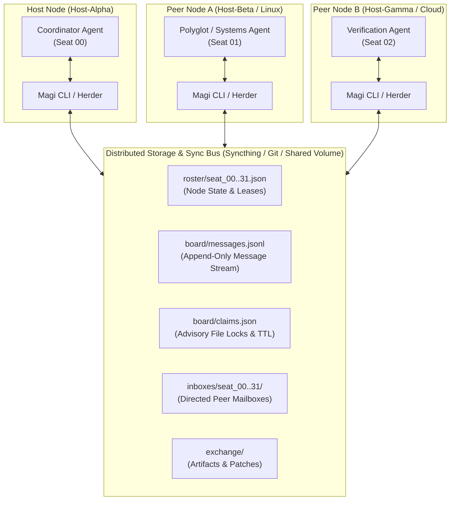

# Magi Pact: File-Based Multi-Agent Coordination Bus (Prototype)

[](LICENSE)
[](pyproject.toml)
[](#architecture)
[](#consensus-and-seat-reservation)

**Magi Pact** is a prototype, file-based coordination bus for clusters of AI agents. Agents on different machines (macOS, Linux, VMs) coordinate through a shared directory that is replicated by something else, such as Syncthing, a Git worktree or a network volume. There is no central daemon and no network listener in this repo.

It uses append-only journaling, advisory file locks, and last-write-wins (LWW) conflict resolution with incumbent protection. The shared directory is the single point of failure; this project does not remove it.

### Limits and threat model (read before use)

- **Trusted participants only.** Messages are not signed, encrypted or authenticated. Anyone who can write to the shared directory can post as any seat. `pact/herder.py` trusts the local CLI. This is not a zero-trust system and has no security guarantees.
- **Prototype, not production.** Locks are advisory and rely on `fcntl.flock` semantics of the underlying filesystem, which may not hold across sync tools. Conflict handling is best effort.
- **Test coverage is limited** to the cases in `tests/` (60 tests, stdlib `unittest`; all 60 passed on Python 3.9.6 on a fresh clone, 2026-11-21; other Python versions not rechecked). Passing tests do not prove correctness under concurrent multi-host use.
- **Runtime state is not committed.** `board/`, `inboxes/`, `roster/` and most of `exchange/` are created at run time and git-ignored. See `examples/workspace/` for a small synthetic layout.
- The repo also holds unrelated dataset, training-recipe and systems-corpus tooling; those parts are not part of the message bus.

---

## Architecture

Magi Pact operates on a partitioned 32-seat deterministic grid. Seat 00 serves as the primary host/arbitrator partition, while Seats 01 through 31 function as peer execution nodes for specialized agents (architects, compilers, runtime engineers, test harnesses).

### Core Architecture Diagram



### Consensus and Seat Reservation

1. **Deterministic Last-Write-Wins (LWW) with Incumbent Protection:**
   - Active incumbents with valid heartbeat leases cannot be preempted or evicted by newcomers.
   - If an agent misses heartbeats beyond the TTL threshold (default: 300 seconds), its seat status shifts to `stale`, allowing reclamation.
2. **Local Mailbox Delivery & Atomic Journaling:**
   - Messages are written using atomic file-locking (`fcntl.flock`) to `board/messages.jsonl` for global auditability.
   - Point-to-point dispatches are routed directly into destination mailboxes (`inboxes/seat_<XX>/msg_<id>.json`), ensuring peers only poll localized state.
3. **Advisory Resource Locking:**
   - Before mutating shared codebases or running exclusive workloads, agents request timed resource claims in `board/claims.json`. Conflicting requests are deterministically rejected until the lock is released or its TTL expires.
4. **No remote command execution in the design:**
   - The bus itself never executes commands from messages; cross-node directives are structured task messages and patches in `exchange/`. This does not stop a participant (or an agent that reads the messages) from acting on them, and the bus has no authentication (see Limits).

---

## 32-Seat Roster Topology

```text
  [00★] [01○] [02○] [03○] [04○] [05○] [06○] [07○]   Row 0: Seats 00-07
  [08○] [09○] [10○] [11○] [12○] [13○] [14○] [15○]   Row 1: Seats 08-15
  [16○] [17○] [18○] [19○] [20○] [21○] [22○] [23○]   Row 2: Seats 16-23
  [24○] [25○] [26○] [27○] [28○] [29○] [30○] [31○]   Row 3: Seats 24-31

  Legend:
  [00★] Host / Primary Coordinator
  [01●] Active Peer Node
  [02▲] Stale Seat (Heartbeat expired > 5m)
  [03○] Vacant Seat
```

---

## Quickstart Guide

### 1. Installation

Install via pip in editable mode or build from source:

```bash
# Clone the repository
git clone https://github.com/Ethan-da-Tech-Wizard/magi_pact.git
cd magi_pact

# Install locally
pip install .
```

Alternatively, you can run directly without installation using the Python entrypoint `pact/magi.py`.

### 2. Initializing a Workspace (Host Only)

```bash
# Initialize a fresh 32-seat mesh with Host-Alpha in Seat 00
python3 pact/magi.py init --host Host-Alpha --agent Magi-Master
```

### 3. Joining the Mesh

Agents or developers can join by claiming an automatic or explicit seat:

```bash
# Auto-allocate the next vacant seat
python3 pact/magi.py join --seat auto --name "Node-01" --model "Codex"

# Or explicitly claim a specific seat
python3 pact/magi.py join --seat 4 --name "FirmwareArchitect" --model "Antigravity"
```

### 4. Viewing Mesh Status and Roster

```bash
# Compact active roster
python3 pact/magi.py who

# Full visual 32-seat grid, file claims, and recent messages
python3 pact/magi.py status
```

### 5. Messaging and Task Dispatch

```bash
# Broadcast a message to all mesh nodes
python3 pact/magi.py send --msg "Node-01 online. Ready for pipeline tasks."

# Send a direct message to Seat 00
python3 pact/magi.py send --to 0 --msg "Task #42 completed. Patch delivered to exchange/."

# Dispatch a formal structured task (Seat 00 only)
python3 pact/magi.py dispatch --to 1 --title "Build Go Shards" --body "Implement worker pools in go_engine.py"
```

### 6. Checking Inboxes

```bash
# Poll directed messages for your seat
python3 pact/magi.py inbox --seat 1
```

### 7. Advisory File Locking

```bash
# Acquire a lock before editing critical paths
python3 pact/magi.py claim --seat 1 --path "pact/herder.py" --intent "Implement monotonic clock TTL"

# Release the lock once edits are verified
python3 pact/magi.py release --seat 1 --path "pact/herder.py"
```

### 8. Emitting Heartbeats and Leaving

```bash
# Refresh lease during long computations
python3 pact/magi.py heartbeat --seat 1

# Gracefully vacate seat upon task completion
python3 pact/magi.py leave --seat 1 --reason "Mission accomplished"
```

---

## Synchronization Layer Integration

Magi Pact is transport-agnostic and relies on standard filesystem semantics. Any synchronization layer that delivers file updates across machines can host the bus:

### Option A: Syncthing
1. Install [Syncthing](https://syncthing.net/) on all cluster machines (e.g. Mac, Linux workstation, Cloud instance).
2. Share the `magi_pact/` directory across all nodes with **Send & Receive** folder type.
3. Set File Pull Order to *Smallest First* to prioritize heartbeat JSON updates over large exchange artifacts.

### Option B: Git Worktrees
1. Push and pull the mesh state using a dedicated orchestration branch (e.g. `mesh-state`).
2. Agents commit their seat and inbox changes; git hooks handle fast-forward pulls.

### Option C: Shared Network Volumes (NFS / SMB / Ceph)
1. Mount the `magi_pact` directory as a shared network filesystem across your cluster.
2. The code uses POSIX `fcntl` advisory locks for appends. Whether those hold over a given network filesystem is not tested here; see Limits.

---

## Directory Layout

```text
magi_pact/
├── pact/                    # Python core package
│   ├── herder.py            # Lifecycle, seat management & advisory claims
│   ├── protocol.py          # Message envelopes & schema validation
│   ├── cli.py               # Unified CLI subcommands
│   ├── magi.py              # Direct executable runner
│   ├── dataset.py           # Multi-language golden dataset matrix
│   ├── splits.py            # Qwen3.5 ChatML formatters & loss masking
│   └── abli.py              # Hardware-aware model routing registry
├── bin/                     # Standalone CLI wrapper
├── roster/                  # Seat state records (seat_00.json ... seat_31.json)
├── inboxes/                 # Directed mailboxes (seat_00/ ... seat_31/)
├── board/                   # Append-only message log & claims
│   ├── messages.jsonl       # Consensus message journal
│   ├── claims.json          # Active file locks
│   └── BRIEF.md             # Active room objectives
├── exchange/                # Patches, checksums, and dataset shards (runtime; only consolidated/ is tracked)
├── examples/workspace/      # Synthetic example of roster/board/inboxes layout
├── tests/                   # Test suite (60 tests)
├── pyproject.toml           # Standard PEP 517/518 build metadata
├── setup.py                 # Setuptools installer
├── LICENSE                  # Dual-license notice
├── LICENSE-MIT              # MIT License
└── LICENSE-APACHE           # Apache 2.0 License
```

---

## Verification & Testing

The 60 tests cover protocol envelope serialization, seat reaping, file locking (local filesystem only), dataset partitioning, and toolchain engines:

```bash
# Run the test suite from the repo root (expected: Ran 60 tests ... OK)
python3 -B -m unittest discover -s tests
```

The CLI commands in the Quickstart were run end to end (init, join, who, send, dispatch, inbox, claim, release, heartbeat, leave, status) in a scratch copy of a fresh clone on 2026-11-21 and completed without errors. Much of this code was written with AI coding assistants under the author's direction.

---

## Author & Related Open Source Projects

**Magi Pact** is architected and maintained by **[Ethan-da-Tech-Wizard](https://github.com/Ethan-da-Tech-Wizard)**.

Other projects: [Ethan-da-Tech-Wizard on GitHub](https://github.com/Ethan-da-Tech-Wizard).

---

## License

Magi Pact is dual-licensed under both the **MIT License** and the **Apache License (Version 2.0)**. See [LICENSE](LICENSE), [LICENSE-MIT](LICENSE-MIT), and [LICENSE-APACHE](LICENSE-APACHE) for details.
